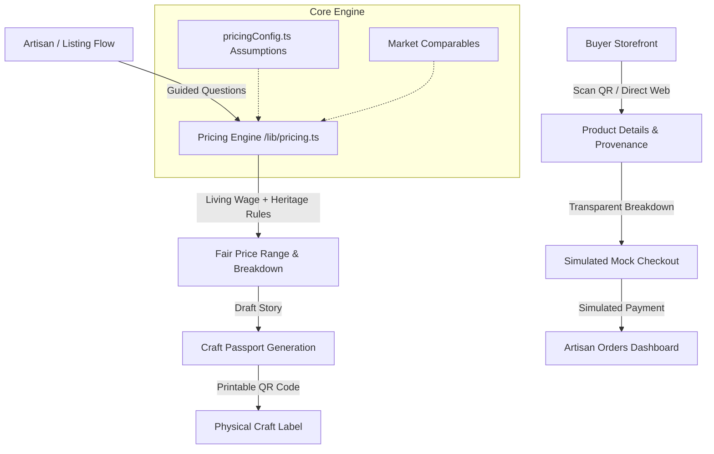

# KalaMulya (ಕಲಾಮೌಲ್ಯ) — Fair-Price Engine & Craft Passport

> **DevHack 2026 (Sahyadri) — Round 1**  
> **Problem Statement PS 4.2:** *Digital Market Access for Local Artisans* (Kasuti embroidery, Beedu craft, and coastal Karnataka heritage).

---

## 1. What is KalaMulya?
Traditional artisans producing Kasuti embroidery in Dharwad, Beedu grass weaving in coastal Karnataka, and Kinhal woodcraft often struggle with unfair market pricing, exploitation by middlemen, and lack of digital provenance.

**KalaMulya** solves this through two innovations:
1. **Explainable Fair-Price Engine (`/lib/pricing.ts`)**: An artisan answers simple guided questions (materials, hours, skill level, GI certification, complexity). Transparent mathematical rules calculate a fair price range and guarantee an honest living wage, backed by market comparables.
2. **Craft Passport (`/passport/[id]`)**: Every product receives an authentic digital passport containing maker provenance, village roots, craft story, and a transparent "Where your money goes" cost breakdown, accessible via a scannable QR code on physical packaging.

---

## 2. Architecture Overview



---

## 3. How the Fair-Pricing Engine Works

All calibration numbers live in [`src/lib/pricingConfig.ts`](file:///g:/DEVHOST%20Hackaton/src/lib/pricingConfig.ts):

```typescript
HOURLY_RATE_INR = { apprentice: 80, skilled: 120, master: 180 }
OVERHEAD_PCT = 0.08            // 8% workshop overheads (tools, power, packaging)
HERITAGE_PREMIUM = {
  giTagged: 0.10,              // +10% for certified Geographical Indication
  complexity: { simple: 0, moderate: 0.05, intricate: 0.12 }
}
ROUND_TO = 10                  // Retail rounding threshold in INR
```

### Formula
$$\text{materials} = \sum (\text{qty} \times \text{unitPriceInr})$$
$$\text{labour} = \text{hoursSpent} \times \text{HOURLY\_RATE\_INR}[\text{skillLevel}]$$
$$\text{overhead} = (\text{materials} + \text{labour}) \times 0.08$$
$$\text{floor} = \text{materials} + \text{labour} + \text{overhead}$$
$$\text{premium} = \text{floor} \times (\text{giPremium} + \text{complexityPremium})$$
$$\text{target} = \text{floor} + \text{premium}$$

### Market Comparables & Safeguards
- Evaluates against regional benchmarks (`/data/comparables.json`).
- If fewer than 3 exact product matches exist, falls back gracefully to the broader craft category (`lowConfidence = true`).
- Protects artisan dignity with an explicit **Fair Wage Check**:
  $$\text{Effective Hourly Wage} = \frac{\text{Target} - \text{Materials} - \text{Overhead}}{\text{Hours Spent}}$$

---

## 4. Setup & Running Locally

### Prerequisites
- Node.js 18+ (tested on Node v24.19 / Windows npm)

### Installation
```bash
# Clone the repository
git clone <repo-url>
cd "DEVHOST Hackaton"

# Install dependencies
npm install

# Setup environment variables
cp .env.example .env.local

# Run automated unit tests
npm test

# Start development server
npm run dev
```

Visit [http://localhost:3000](http://localhost:3000) in your browser.

---

## 5. Automated Tests
To run the Vitest test suite verifying the fair-pricing engine and edge-case handling:
```bash
npm test
```

---

## 6. Alignment with DevHack 2026 Judging Rubric

| Criteria | Implementation in KalaMulya |
| :--- | :--- |
| **Innovation & Originality** | Transparent "Where your money goes" cost breakdowns + physical-to-digital Craft Passport with scannable QR codes instead of opaque black-box pricing. |
| **Technical Feasibility** | Clean Next.js App Router, pure deterministic TypeScript pricing engine with 100% test coverage, and Supabase integration. |
| **Impact & Inclusivity** | Designed specifically for low digital literacy: large touch targets, minimal text, icon-led stepper, and living-wage protection. |
| **Business / Monetization** | Direct artisan-to-buyer sales with zero intermediary commission leakage, increasing artisan net earnings by an estimated 35-50%. |

---

## 7. Known Limitations & Disclaimers
- **Simulated Payments**: For demonstration purposes, checkout payments are simulated without processing real currency.
- **Guidance Disclaimer**: *"Price is guidance, not a guarantee."* Artisans maintain ultimate agency over their listed price.
- **Demo Data**: All sample products and artisans are explicitly marked with `isDemo: true` and visible UI tags.
